# Examples

Each example is a small notebook you can copy, with its code below it.
Hover over a figure, click a mark, or drag a box, and the cells below it
respond. [Examples on this site](@ref this-site) says how the examples
work without Julia running.

## Analyses

A click or a box feeds the next step of an analysis.

```@raw html
<div class="masque-gallery">
<a class="masque-gallery-card" data-page="cluster">
  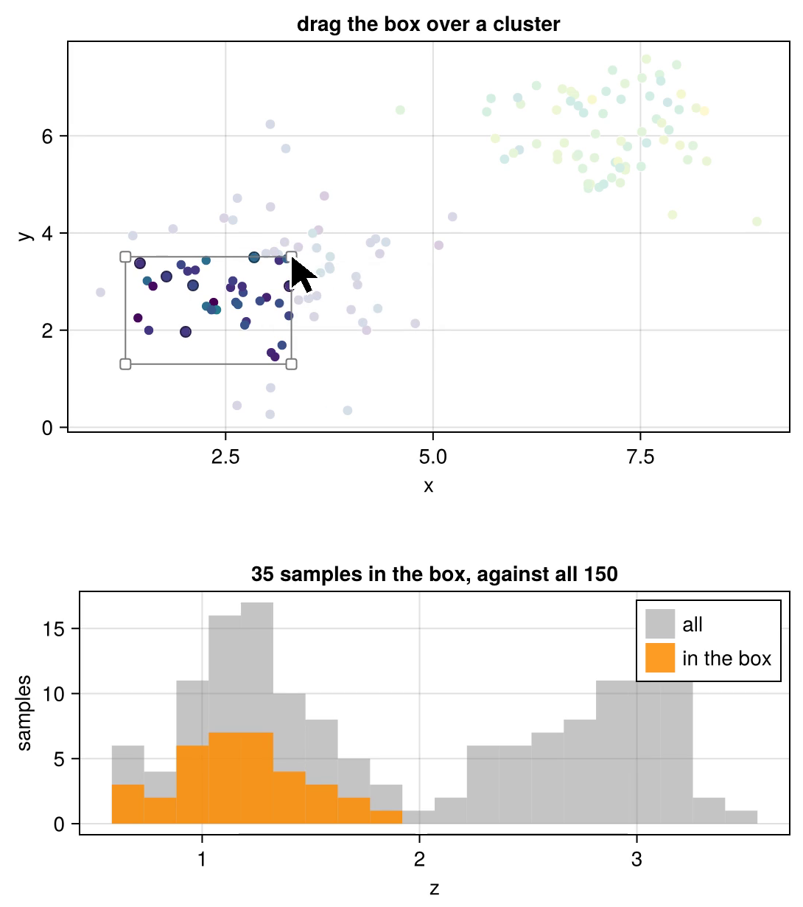
  <span>Compare a cluster</span>
</a>
<a class="masque-gallery-card" data-page="threshold">
  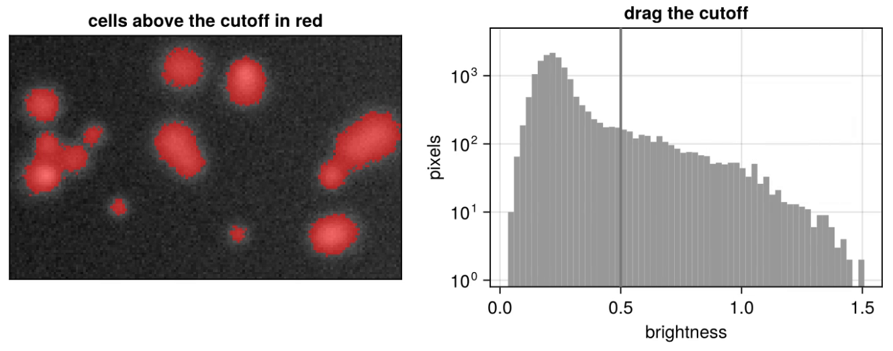
  <span>Threshold a mask</span>
</a>
<a class="masque-gallery-card" data-page="segmentation">
  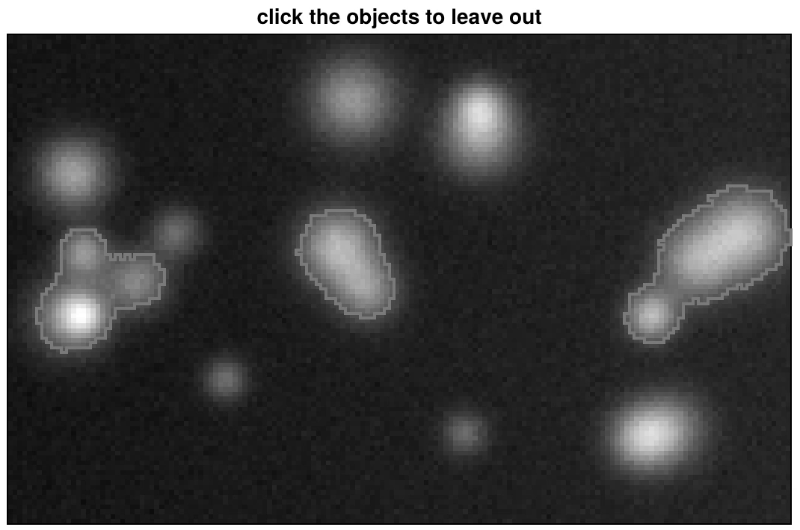
  <span>Annotate a segmentation</span>
</a>
<a class="masque-gallery-card" data-page="linked">
  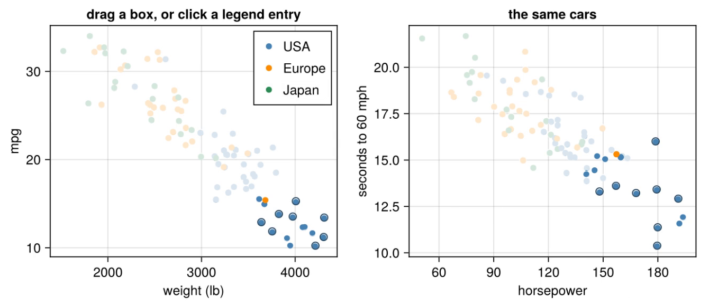
  <span>Filter one plot from another</span>
</a>
<a class="masque-gallery-card" data-page="heatmap-trace">
  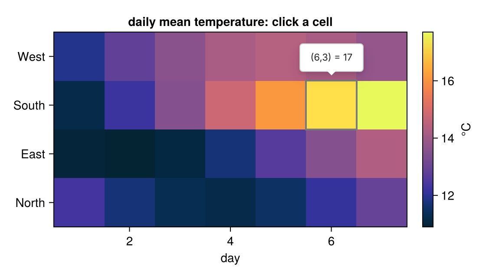
  <span>From a heatmap cell to its trace</span>
</a>
<a class="masque-gallery-card" data-page="boxselect">
  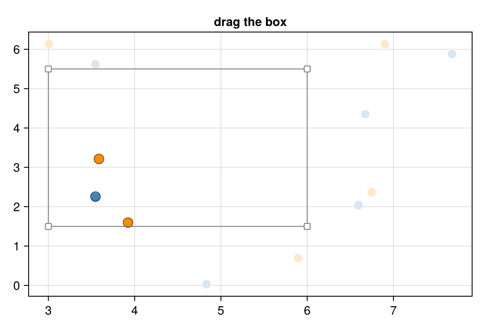
  <span>Box-select scatter</span>
</a>
<a class="masque-gallery-card" data-page="image">
  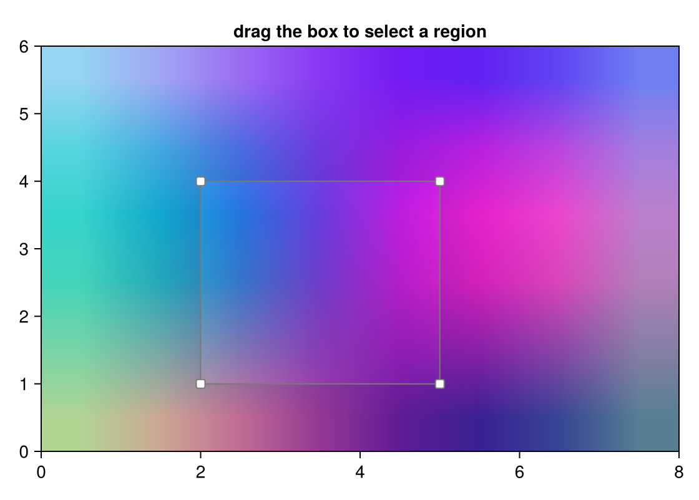
  <span>Image ROI</span>
</a>
</div>
```

## Plot types

Each of these plots has its own page: what a click returns, how to show
your own data in the tooltip, and the options that plot has. [All plot
types](plots.md) lists every plot that has a page.

```@raw html
<div class="masque-gallery">
<a class="masque-gallery-card" data-dir="plots" data-page="violin">
  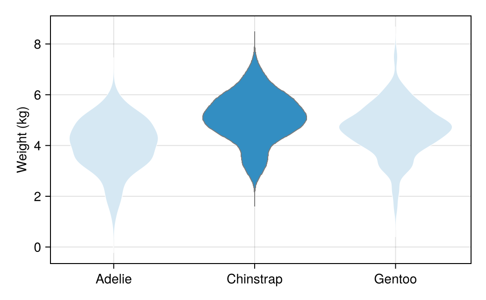
  <span>violin!</span>
</a>
<a class="masque-gallery-card" data-dir="plots" data-page="boxplot">
  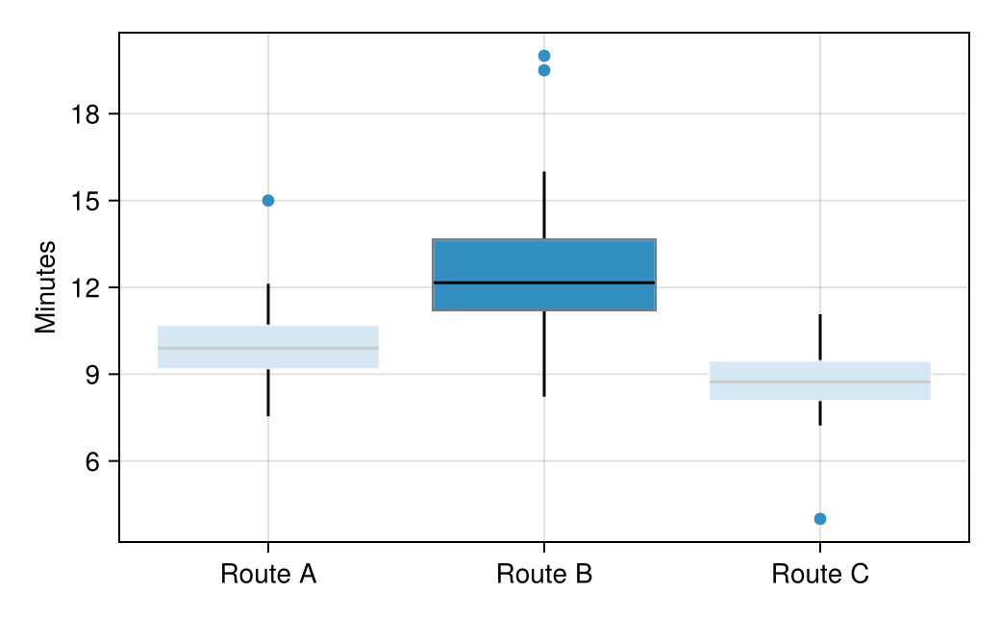
  <span>boxplot!</span>
</a>
<a class="masque-gallery-card" data-dir="plots" data-page="rainclouds">
  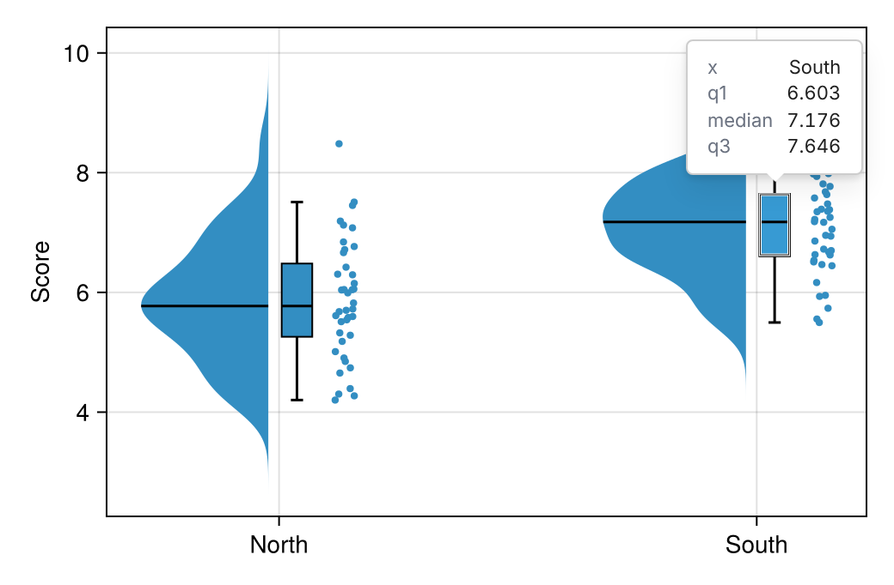
  <span>rainclouds!</span>
</a>
<a class="masque-gallery-card" data-dir="plots" data-page="density">
  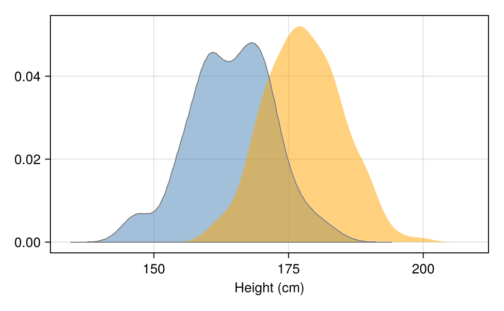
  <span>density!</span>
</a>
</div>
```

These pages show what `masque(fig)` makes interactive on several plots
at once.

```@raw html
<div class="masque-gallery">
<a class="masque-gallery-card" data-page="bars">
  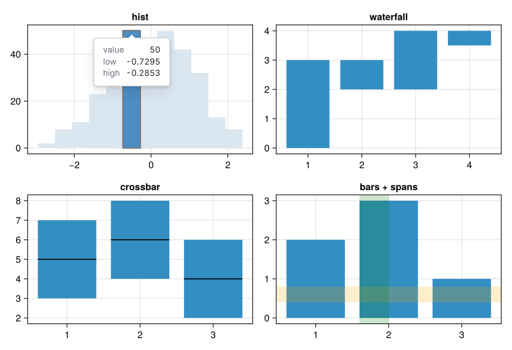
  <span>Bars and areas</span>
</a>
<a class="masque-gallery-card" data-page="polygons">
  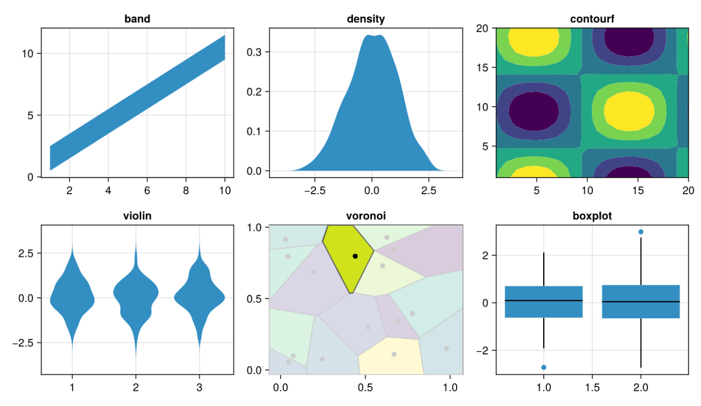
  <span>Polygons</span>
</a>
<a class="masque-gallery-card" data-page="text">
  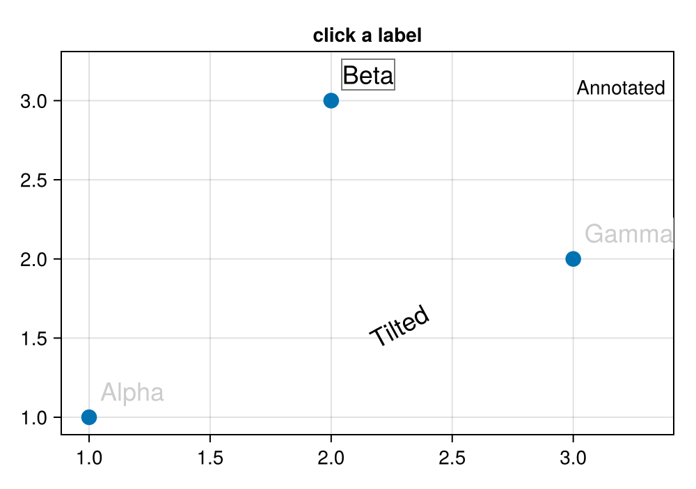
  <span>Text labels</span>
</a>
</div>
<script>
(function () {
  var pretty = /\/$/.test(location.pathname) || /\/index\.html$/.test(location.pathname);
  var root = pretty ? "../" : "";
  document.querySelectorAll("a.masque-gallery-card").forEach(function (a) {
    var page = a.getAttribute("data-page");
    var dir = a.getAttribute("data-dir") || "gallery";
    a.href = root + dir + "/" + page + (pretty ? "/" : ".html");
    var img = a.querySelector("img");
    if (img) img.src = root + "assets/gallery/" + page + ".png";
  });
})();
</script>
```
