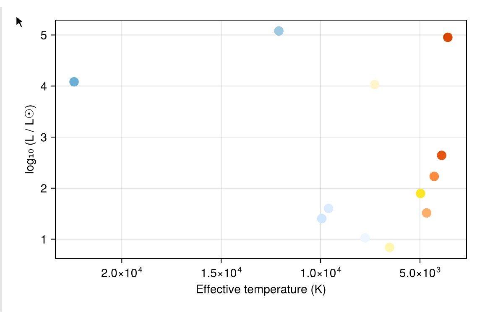
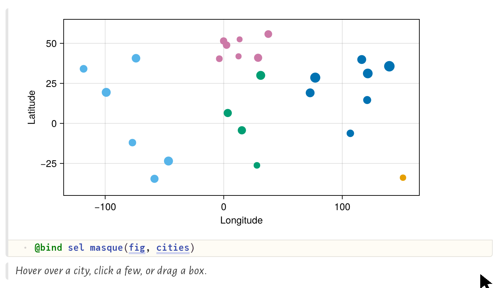
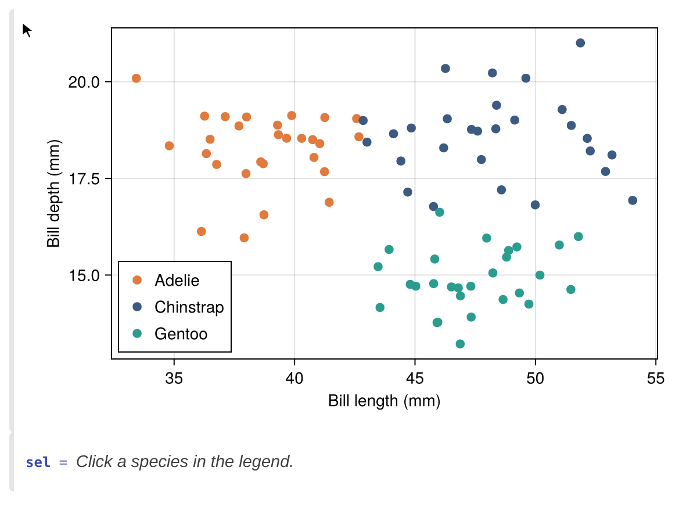

# Masque.jl

Masque adds tooltips and click selection to Makie figures in a Pluto
notebook. Clicking a mark updates a `@bind` variable, so the rest of your
notebook can respond. [Ready to get started?](getting-started.md)

## [Tooltips](@id home-tooltips)



Hover over a point, bar, heatmap cell, or polygon to see its data in a
tooltip. You choose what the tooltip says. See [Tooltips](@ref).

## Select marks



Click a mark to send it to your notebook. With `select = :many`, each
click adds a mark, and dragging a box picks every mark inside it.
Ctrl-Z (Cmd-Z on a Mac) takes back the last change. See
[What each mark returns](@ref) and [Selection](@ref).

## [Build a widget](@id home-widgets)

```@raw html
<div class="masque-embed-wrap">
<iframe id="masque-home-controls" data-masque-embed="controls_wave" data-masque-segment="widget" title="A sine curve with a frequency slider and a dotted-line toggle. Moving either redraws the curve." style="width:100%;height:620px;border:0;background:transparent;overflow:hidden;" scrolling="no" loading="lazy"></iframe>
</div>
```

Lay out a Makie slider, toggle, or menu in the figure, and it works in
the notebook next to the marks you can pick, all in one `@bind` value.
With `onchange`, the figure redraws as the reader moves a control,
without running the cell again. [Build a widget](@ref) walks through
one that labels points into classes.

## [Pan, zoom and orbit](@id home-pan-orbit)

```@raw html
<video class="masque-loop" src="assets/home/orbit.mp4" width="1456" height="828"
       muted loop playsinline autoplay
       aria-label="Dragging the pointer on an Axis3 trefoil knot in a Pluto cell orbits the camera"></video>
```

Drag a 2D axis to pan, or an `Axis3` to orbit, and scroll to zoom
either. See [Pan, zoom and orbit](@ref).

## Highlight from the legend



Click a legend entry to highlight the traces it labels, and a cell that
uses the selection can fade the others, as in this example. See
[Legend](@ref).

## [Publish outside Pluto](@id home-publish)

Tooltips and highlights keep working in a static HTML export of your
notebook, like the figure below: hover over a borough to try it. See
[Publish outside Pluto](@ref).

```@raw html
<div class="masque-embed-wrap">
<iframe id="masque-home-export" data-masque-embed="home_export" title="New York City boroughs. Hover a borough to see its name." style="width:100%;height:520px;border:0;background:transparent;overflow:hidden;" scrolling="no" loading="lazy"></iframe>
</div>
```

## [Backends](@id home-backends)

Masque works with CairoMakie and WGLMakie. See [Backends](@ref) to
choose between them.

Next: [Getting started](@ref) installs Masque and makes a first figure
interactive.
